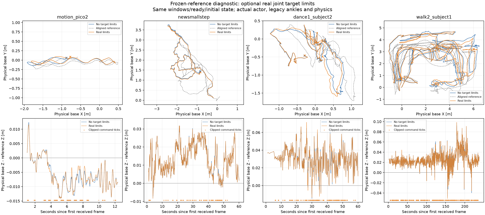
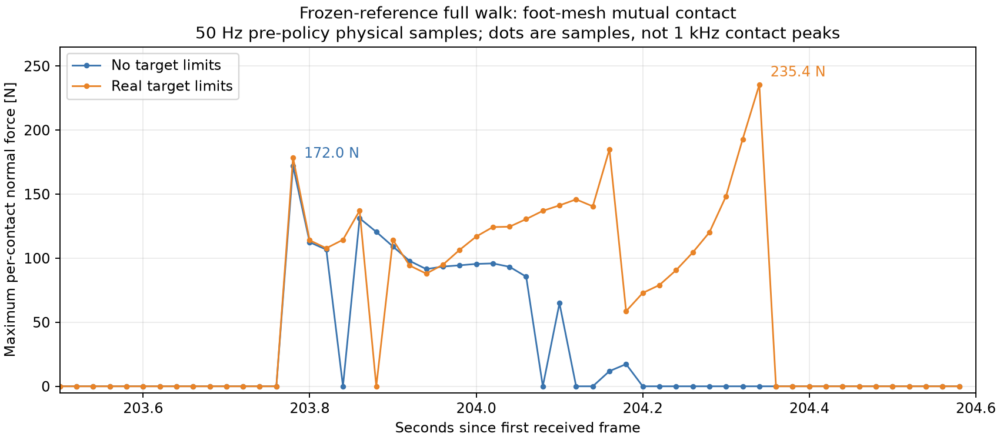

# SuperMimic 旧部署路径与目标角限幅对照

2026-11-04，按要求恢复原并联求解算法和原 motion buffer 语义。

- Super 使用独立 `LegacyRealtimeMotionBuffer`，与 real 原接收器等价：本地墙钟插入/查询，首包立即 ready，base_link[0]，无隐式加高、源时间预充或 generation/stale 状态。
- 进入模式首步初始化 yaw/action/history；首包到达再次对齐 yaw，保留动作和状态历史。
- 原 `ParKine` 正逆解、SDK PD 和策略反馈使用同一旧 ABI。共享接口导致其他 sim 模式也恢复旧脚踝算法；普通 ZMQ/fixwrist 的 source-clock buffer 保持原配置。
- 原解算负返回恢复单腿 PR 位置/速度置零；通用非有限值/物理异常隔离保留。
- 模型、关节映射、增益、XML 和物理模型未修改。

## 可选目标角限幅

默认关闭；开启只限制物理 PR 目标，不裁剪 raw action 或 history：

`target = clip(q0 + action_scale * raw_action, SDK lower, SDK upper)`

当前27关节限位按名字与 real 一致；四踝使用 pitch `[-.52,.61]`、roll `[-.35,.35]`。配置项为 `jakaminimimic_superzmq.clip_target_positions`，要求 `angle_map=0`。

```bash
cd /home/cxr0726/workspace/JAKA_comparison/sim/demo
./scripts/run_super_npz_demo.sh scripts/newsmallstep.npz --viewer --duration 0 --target-limits none
./scripts/run_super_npz_demo.sh scripts/newsmallstep.npz --viewer --duration 0 --target-limits real
```

NPZ 默认不加高；显式 `--height-offset` 在发布端统一平移世界 Z 一次，不改变 buffer 时间轴。诊断记录保留 raw action、限幅前后目标和明确的 legacy backend 标记。

## 实测方法和结果

代码回退提交为 `d19be14`。测试使用当前 `ckpt_0100000_new.onnx`（SHA256 `67877118414560c830491e43fdeb405011a222aecf75310be368c8d1cbef4c6b`）和未改动的完整 CAD 脚凸包 `Khan_mini_contact.xml`（SHA256 `6ac34aa81b73eeb89f10d52963f7b90324a5346b5ac67d8565708f9efa859f1b`）。策略周期20ms，物理步长1ms，参考高度偏置0；两组其他配置、模型、初态及二进制一致。`real` 开关只复现实机目标角限位，不代表复制全部实机执行器动力学。

共运行18次真实闭环仿真、89,472个策略周期，全部正常退出：四动作完整实时ZMQ播放各一对（8次），固定参考窗口各一对（8次，其中舞蹈/步行先取前60秒），再追加完整步行固定窗口一对（2次）。没有运行实机控制。

实时ZMQ的到达时序不能保证两组逐周期相同，因此补充固定窗口诊断：只替换诊断版参考取样为记录下来的逐tick窗口和ready事件，实际反馈、旧AB正解、actor、history、PD和MuJoCo物理继续闭环运行。5个不限幅冻结基线共22,043周期均逐数值精确复现对应实时基线（obs、action、target、关节反馈、真实关节/基座状态最大差全0）。冻结两组窗口/ready完全一致，用于识别限幅本身的影响。

下表均为固定参考窗口结果，箭头为不限幅→实机式限幅。关节RMSE比较真实关节与当前参考；XY参考按首次ready的基座位置及yaw对齐，避免把NPZ绝对坐标与spawn原点直接相减。统计排除首个ready后1秒的切入期。

| 动作 | 固定窗口范围 | 腿部关节RMSE / rad | 参考XY终点误差 / cm | 两组XY终点位置差 / cm |
| --- | --- | ---: | ---: | ---: |
| `motion_pico2` | 全段12.36s | 0.06770 → 0.06869 | 30.9 → 20.5 | 10.5 |
| `newsmallstep` | 全段60.08s | 0.07683 → 0.07670 | 159.3 → 154.8 | 5.2 |
| `dance1_subject2` | 前60s | 0.09930 → 0.09962 | 75.6 → 75.3 | 0.5 |
| `walk2_subject1` | 全段238.16s | 0.09351 → 0.09410 | 55.7 → 21.2 | 35.0 |

两组所有动作均未触发持续跌倒判据：参考保持较高/直立时，实际base低于0.35m或up-z低于0.25持续0.2s。它不是人工观看后的主观评价，也不是实机稳定性证明。raw action/history、原始目标及限幅后目标的逐周期公式核对最大误差均为0。



### 完整步行的脚部互撞

固定参考238.16秒全段中，足mesh互撞从17增加到29个50Hz采样周期（法向力阈值>1N），最大连续接触从11增加到23个周期；采样到的单接触法向力峰值从171.97增加到235.43N。主要事件在首次ready后约203.78–204.36秒，限幅组另在199.74秒有一次短接触。这是同窗口闭环对照，排除了两组网络到达相位差。数值为50Hz接触采样，不能称为1kHz真实峰值或完整接触持续时间。



目标角限幅因而能够影响后段足间接触和冲击，即使腿部RMSE仅增加约0.63%、没有跌倒。全段参考XY终点误差却由55.7cm降至21.2cm；前60秒相反，是20.4→28.2cm。因此位移跟踪和局部接触不能合并为单一的“改善/恶化”结论。

### 踝部频段检查

复用50Hz策略采样的真实PR角度，4秒Hann窗口、50%重叠、逐段线性去趋势、单边PSD能量归一化，积分10–25Hz并合并四踝RMS，单位为度。此频段不能覆盖真实电机1kHz反馈的完整频谱。

| 动作/同上固定范围 | 四踝10–25Hz角度RMS / deg |
| --- | ---: |
| `motion_pico2` | 0.0910 → 0.0913 |
| `newsmallstep` | 0.1012 → 0.1020 |
| `dance1_subject2` | 0.2597 → 0.2664 |
| `walk2_subject1` | 0.2384 → 0.2423 |

本轮没有复现倍数级高频抖动增加，但这不能排除实机额外电机阻尼、并联力矩映射或延迟与限幅的耦合。当前结果支持“限幅有实际控制影响，尤其累计平移和特定脚间碰撞”，不支持仅凭限幅就解释实机全部严重抖动。

## 控制含义及后续使用

策略允许目标越过机械关节范围，以产生PD力矩请求；实际关节是否越限是另一项物理约束。在相同q、qd下，未饱和PR力矩请求的变化为 `Δτ = Kp * (q_clipped - q_raw)`，之后仍有SDK并联映射和力矩限制，不能把此请求差直接当实际AB电机力矩。训练不做目标角裁剪、部署做裁剪，会产生这种控制律差异。

仿真默认继续关闭此可选限幅。若要核对实机限制下的表现，使用前述 `--target-limits real`；若后续将限幅作为部署规范，应在训练/验证中同步其语义并重新评估，不凭单个动作或单个终点指标判断。

## 编译与回归检查

完整仿真可执行文件编译通过；10项CTest全部通过。原碰撞模型测试已有armature断言过时：四个具名drive DOF在sym是.025、当前CAD是.016（在本次回退之前已存在），已将测试改为显式验证这四项，其余57 DOF及质量/惯量/阻尼等原约束继续严格检查。未修改XML或物理参数。

详细机器可读统计见 [结果JSON](legacy_target_limits_results_20261104.json)。原始轨迹、诊断变体源码、编译/实验manifest和复现校验保留在工作区 `diagnostics/sim_legacy_limits_20261104/`；这些日志和大体积trace未加入Git。
