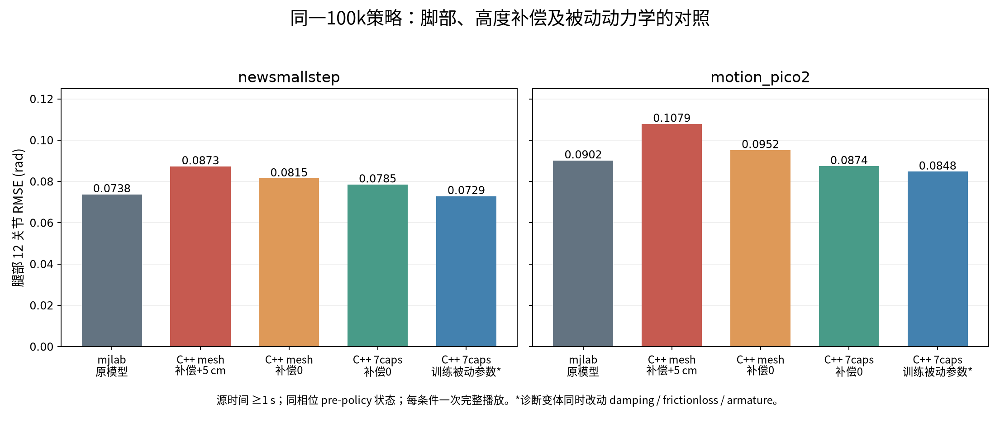

# mjlab 与 C++ 的 OOD 播放核查（2026-11-02）

> 本报告对应旧 `Khan_lafan1_clean_goal` 100k 策略、训练七 capsule 与踝 pitch armature .016。新 `khan_lafan1_delay_covex` 已改为整脚 CAD convex 和 pitch .3；新策略首次起身诊断见 [new100k_getup_comparison.md](new100k_getup_comparison.md)，不能直接沿用下面的旧训练参数。

这次比较明确使用 `run_super_npz_demo.sh` / `jakaminimimic_superzmq`，动作是 `newsmallstep.npz` 与 `motion_pico2.npz`。结论是：当前默认 C++ 播放确实有可测的腿部跟踪差距，但主要可由参考高度和执行层模型差异解释。临时换 7 capsule 有改善；并未发现同一模型的关节排列、620 维观测拼接、IMU 坐标、策略推理或 PD 参数迁移错误。

## 实测结果与比较方法

完成了 12 组无 viewer、实时 ZMQ 完整播放，每组只有一个条件组合的一次运行。C++ 使用当前生产求解器和安全预检；诊断副本仅在 FSMUpdate 前增加真实物理状态/接触记录，不改变控制计算或 SDK 物理调用。所有组退出码为 0，无解算故障或 NaN。

mjlab 参照来自所引用对话核验的原始完整录制。两边原始 NPZ 字节相同、模型 checkpoint 相同。统计使用源时间从 1 秒到片段结束，剔除接入早期与尾部保持。C++ 使用物理状态与当前实际采样参考配对；mjlab 录制原本是“积分后状态 / 本步 reward 参考”，本次另以 `robot_qpos[:-1]` 配 `ref_qpos[1:]` 得到“策略调用前状态 / 本步参考”，避免引入 20 ms 的比较相位差。表中是 12 个腿关节的物理角度 RMSE，越低越好。

| 条件 | newsmallstep / rad | motion_pico2 / rad |
| --- | ---: | ---: |
| mjlab，同相位前策略状态 | 0.073783 | 0.090182 |
| C++ 当前 mesh，参考 +5 cm | 0.087326 | 0.107901 |
| C++ 当前 mesh，参考 +0 cm | 0.081472 | 0.095191 |
| C++ 只换 7 capsule，参考 +5 cm | 0.086449 | 0.102973 |
| C++ 只换 7 capsule，参考 +0 cm | 0.078547 | 0.087425 |
| C++ 全身改训练接触，参考 +0 cm | 0.078558 | 0.087680 |
| C++ 7 capsule + 训练式被动参数，参考 +0 cm | 0.072881 | 0.084785 |

最后一行是诊断变体，同时改变 joint damping、frictionloss 和多组 armature；它说明这个被动参数组合有贡献，不能将全部改善单独归因某一个 armature 数值。它也不代表已经标定实机参数。每条件仅一次运行，小于百分之几的差别不宜解读为稳定优势。



## 1. 默认参考高度是明确的播放语义差异

`pub_motion_super_npz.py:152–159` 对未命名的 Isaac NPZ 推断 layout 时，还同时给它 `reference_height_offset=0.05`；具名 JAKA NPZ 则给 0。启动器会将这个默认值写进该次 C++ 配置。两个动作恰好是未命名 27-joint / 28-body 文件。

mjlab 的最小适配只补名字和重排 q，保留原始 root 高度。两个原始首帧高度约为 0.6484 m，C++ 默认送给策略的约为 0.6984 m。因此，同一动作的 goal 中五个绝对高度输入全部多了 5 cm。对 `motion_pico2`，当前 mesh/+5 cm 的平均命令高度误差约 5.32 cm；改为 +0 cm 后约 0.77 cm。

严格复现这两段 mjlab 播放，应显式使用 `--height-offset 0`。这不否定现场 Pico 参考偏低时人工 +5 cm 校准的用途；离线文件的布局与高度是否已校准是两个独立属性。当前“根据 layout 同时推断校准量”的做法容易造成不公平比较，后续应让校准量显式记录在数据/播放配置中。

## 2. 7 capsule 有改善，脚部互撞不是这两段的统一解释

临时模型只替换两脚的碰撞几何，保留原 visual、非足部 CAD、材料、质量/惯量、并联机构、关节参数和五位碰撞 mask。编译后的尺寸约为：

| 几何 | 长 × 宽 × 高 | body-local Z 范围 |
| --- | --- | --- |
| 带脚背的整脚凸包 | 199.93 × 95 × 62 mm | -48 至 +14 mm |
| 训练的 7 capsule 联集 | 206 × 80 × 20 mm | -48 至 -28 mm |

底面高度基本一致。7 capsule 更窄、没有整脚上方的脚背/连接凸包斜面，同时略长；它也改变了接地时的支撑包络。

在相同 +0 cm 条件下，腿 RMSE 从 0.081472 降至 0.078547、从 0.095191 降至 0.087425。完整脚 mesh 因而确实有贡献，但改善并非无限大。`motion_pico2` 在 50 Hz 采样中各组都没有检测到脚脚或异侧脚腿接触；`newsmallstep` 的脚脚接触计数也不随 capsule 单调减少。不能把所有差距都归因于 mesh 互撞。这些接触统计是控制频率采样，不是 1 kHz 子步接触积分。

全身接触一并换为训练定义，与“只换脚”的这两段结果几乎相同。说明在这两条以站立/走动为主的 OOD 中，base/小腿几何不是主要因素；这不推及下跪、摔倒、起身。

## 3. 并联机构与训练直驱模型的被动动力学差异很大

两边 PD metadata 正确映射到当前 SDK，真实 SDK 的 FSMInit 顺序探针与解析 PD / Jacobian 控制输入完全一致。`ankle_damp_scale` 不参与该路径；raw PR 输出没有隐藏目标裁剪。

但是，训练使用 27 个物理 hinge / PR 的直接 position actuator；SDK 保留 drive、球关节和软约束。SDK 还给这些自由度设置了被动参数：

| 项目 | 当前 SDK | mjlab 训练 |
| --- | --- | --- |
| joint damping / frictionloss | 默认 0.01 / 0.1，包含并联被动关节 | 0 / 0 |
| physical PR armature | pitch/roll 各 0.01 | 各 0.016 |
| drive armature | 各 0.025 | 无 drive DOF |
| ball armature | 每轴 0.01 | 无 ball DOF |
| 物理积分 | Euler，1 ms × 20 | implicitfast，5 ms × 4 |
| 最终力矩限制 | 在 drive 坐标限制 | 在 PR 坐标限制 |

令 `J = d[pitch,roll]/d[a,b]`，则 `v_AB = J⁻¹ v_PR`。仅 physical PR 和 drive 的 armature 折算到 PR 的矩阵是：

`M_arm,PR = 0.01 I + J⁻ᵀ (0.025 I) J⁻¹`。

中性位约为 `[[0.117654,0.000315],[0.000315,0.020292]] kg·m²`，训练是 `diag(0.016,0.016)`。仅这一部分的 pitch 就是训练的 7.35 倍；在 pitch=-0.5、roll=-0.3 时该比值约为 29.23。这里尚未加球关节 armature 或实体惯量，不是完整质量矩阵。

因此，保持同名 Kp/Kd 不会得到相同带宽和阻尼响应。把额外被动参数改为训练式参数后，腿跟踪指标进一步接近 mjlab，支持“执行层不一致有贡献”。不能据此直接把实机仿真模型的 armature 清零；应结合实际电机转子、减速比、机构 Jacobian 和摩擦辨识，让训练与部署使用同一物理定义。

## 4. 起步与实时选窗条件不同，但本轮未复现稳态追赶问题

mjlab 将首帧 root 位姿、根速度、关节 q/qd 直接写入仿真，再从第 0 帧开始。C++ 先以默认站姿启控，再接入在线参考。首包后预充 500 ms，查询延迟为 `4×20+40=120 ms`；同时发布器继续推进动作。本轮首次 Tracking 的源时间约为 0.38–0.41 s，已经接近第 19–21 帧。

`newsmallstep` 最初 380 ms 内腿关节变化最大约 0.312 rad；`motion_pico2` 约 0.034 rad。它们的首帧腿速度范数约为 0.597 / 1.55 rad/s，而 C++ 接入前接近静止。这给在线接入带来额外瞬态，不是相同初态的 benchmark。

本轮无 viewer、同机 NPZ ZMQ 回放中，稳态物理步进固定为 20 ms，墙钟平均间隔约 20 ms；头八组最大间隔约 22.96 ms，没有 >40 ms 或 <10 ms 的稳态间隔，仿真/墙钟推进比约为 1。窗口没有 underrun/stale，未复现连续物理追赶造成的大幅错位。这项结论只覆盖本次回放条件。

## 5. 已排除的迁移疑点

- 两边 ONNX SHA256 完全相同：`83468dee3816653d6548ebc1000aa8bee0aed411101787e0a5b44dfc59edf21e`，对应同一 clean_goal 100k checkpoint。
- `155 goal + 30未来姿态 + 435传感器历史` 正是模型声明的 `155 + 465`；未来姿态不是错误插入的历史项。
- 当前训练公式重算真实 C++ tape 的 300 连续 tick：obs 最大误差约 5.65e-7；ORT 动作相同，Torch 动作最大误差约 2.62e-6。十二组实际 goal 的 q 与独立 buffer 重排最大差都是 0。
- 完整一次 newsmallstep 的 3127 tick 中，SDK/imu_process 姿态与物理 base 一致；角速度与真实 link-local 角速度一致。普通关节 q/qd 与真实 hinge 状态一致。
- 正常八组中，真实 PR 与并联正解反馈的 RMS 差约 0.00146–0.00222 rad，最大小于 0.00933 rad。没有重现旧版错误根。
- SDK 正常 PD 探针误差为 0；raw PR target=0.8、2.0 原样保留且有限，排除了输出端隐藏裁剪或无效 IK 替换的疑点。

物理角速度核查使用 `mjOBJ_XBODY`；`mjOBJ_BODY` 的 local frame 是惯性主轴，不是 link axes。两者区别见 [MuJoCo 官方实现](https://github.com/google-deepmind/mujoco/blob/3.4.0/src/engine/engine_core_util.c)。本次还通过姿态微分独立验证了角速度。

## 可视化 A/B 命令

便携的临时文件为 `sdk/assets/khan_mini/Khan_mini_contact_7capsule_test.xml`。生产默认仍为完整脚 mesh。该便携文件已由实际 SDK 3.4 加载，并用生产启动器完成 16 秒 pico2 播放，`err=0`。

在 `sim/demo` 下，每次执行一条命令。两条使用相同高度补偿，便于只比较脚形状：

```bash
./scripts/run_super_npz_demo.sh scripts/newsmallstep.npz --viewer --duration 0 \
  --height-offset 0 --xml ../sdk/assets/khan_mini/Khan_mini_contact.xml

./scripts/run_super_npz_demo.sh scripts/newsmallstep.npz --viewer --duration 0 \
  --height-offset 0 --xml ../sdk/assets/khan_mini/Khan_mini_contact_7capsule_test.xml
```

将动作文件替换为 `scripts/motion_pico2.npz` 即可测试另一段。保留 +5 cm 时，两个命令都改为 `--height-offset 0.05`。脚本仍然先开启控制，再从动作开头发布；当前脚模型只影响碰撞，visual 外观保持原 CAD。

## 证据与范围

工作区 `diagnostics/ood_cpp_compare_20261102/` 保存完整 12 组逐 tick 状态、buffer 时间、接触、SHA manifest、`run_metrics.json`、`compact_metrics.md`、模型变体与 SDK 探针；同级 `ood_obs_contract_20261102/` 保存网络/反馈复核。生成与运行脚本也保留，便于重算。完整数据没有新增进 Git。

本次只分析这两条 OOD；mjlab 原视频也存在全局 XY 漂移，pico2 末帧约 1.75 m。局部腿部姿态更好不代表世界路径完全准确。数据最后的较大身体倾斜也应对照参考：newsmallstep 最后参考倾角本就约 42.6°，不能单用最大绝对倾角判为摔倒。
