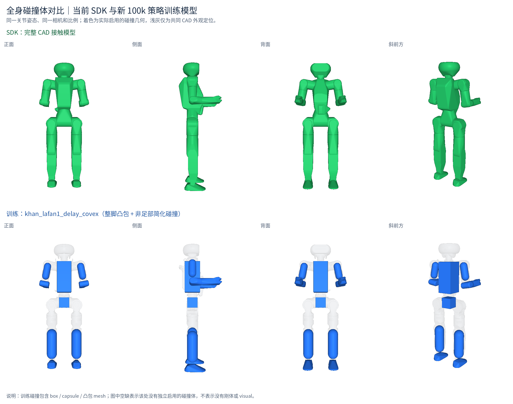
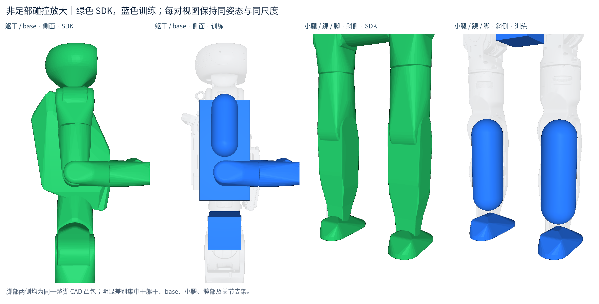

# 新 100k 策略第一次起身踉跄：C++ / mjlab 对照

2026-11-03。对象是 `khan_lafan1_delay_covex/ckpt_0100000.pt` 与当前 C++ `ckpt_0100000_new.onnx`，动作 `fallAndGetUp2_subject2.npz`，参考高度偏置为 0。用户进一步说明现象是“第一次起身踉跄”。本次实测当前 C++ 在第一次起身有明显瞬态偏差，但约 18 s 已恢复站立，不能描述为本次始终起不来。

结论：**这段第一次起身的主导差异是全身接触模型。只对齐训练接触，保留当前 SDK 并联机构、求解器、armature、阻尼和摩擦，就基本复现 mjlab；只改被动动力学参数没有解决这段踉跄。** 脚在这些对照中始终是完整 CAD 凸包，新策略训练已经不用旧的七 capsule。

## 实测方法与范围

读取了用户引用的“配置训练环境并运行 smoke test (5)”对话，并重新用当前训练代码运行一次相同 PT 的无 viewer 录制：关闭观测/动作噪声、DR、执行器 delay 和自动 reset，8196 步完整完成，无提前失败，归一化回报 0.844774。复用训练 `scripts/analysis/eval_khan_ood.py` 的 recorder；结果写入本工作区，不改训练代码。

C++ 使用与当前生产代码一致的诊断副本：唯一差异是 FSMUpdate 前记录 MuJoCo qpos/qvel 和接触。`diff -qr` 核对生产 src 时只有这个主文件诊断插入不同。使用相同 SDK、当前修复后的求解器和每子步安全预检；控制先启动，收到有限的 SuperMimic state 后才启动 NPZ publisher；每次独立配置、端口和日志。

各条件一次运行，不能将小数点后细微差异解释为稳定优势。当前配置、仅被动参数、被动参数+接触进行了完整播放尝试；训练接触单改与关闭自碰撞为 26 s 的首段测试，viewer 基线为 24 s。mjlab 的 pre-policy 统计采用录制 `robot_qpos[:-1]` 对 `ref_qpos[1:]`；C++ 用实际 buffer 查询参考对同 tick 的物理真值。横轴为动作源时间，不是程序启动后的仿真时间。

## 第一次起身的受控消融

14–18 s，每条件 200 个 50 Hz 控制样本：

| 条件 | 12 腿关节 RMSE / rad | 全身关节 RMSE / rad | 重力方向误差均值 / ° |
| --- | ---: | ---: | ---: |
| 当前 C++，无 viewer | 0.33028 | 0.34014 | 29.75 |
| 当前 C++，有 viewer | 0.28376 | 0.29382 | 22.19 |
| 仅匹配训练被动参数 / armature | 0.32730 | 0.36425 | 29.56 |
| 当前 CAD 对地接触，仅关闭机器人自碰撞 | 0.26185 | 0.27186 | 19.86 |
| **仅匹配训练接触，保留当前 SDK 动力学** | **0.19296** | **0.16038** | **5.21** |
| 匹配训练接触+被动参数 | 0.19312 | 0.16040 | 5.15 |
| mjlab 当前 100k PT | 0.19465 | 0.16174 | 5.62 |

当前 C++ 在 15 s 实际 base Z 约 .147 m、参考 .247 m，起身时明显迟滞与摆动；18 s 实际 .637 m、参考 .609 m、倾角 7.79°。18–20 s 腿部误差已降至 .06412 rad，与 mjlab .06478 接近。单独以最终是否站立、或何时 Z 首次越过某阈值，不能反映这段过程质量。

关闭自碰撞只能部分改善，仍明显差于训练接触。因此不能将原因简化为某一对自碰撞，更不能把“关闭所有自碰撞”当作最终实机建模修复。

首次起身曲线保存在工作区 `diagnostics/getup_new100k_20261103/first_getup_comparison.png`；复算脚本为 `analyze_cases.py`、`analyze_first_getup.py`，原始统计为 `comparison_metrics.json`、`first_getup_metrics.json`。

## 接触差异的具体证据

下面两图由当前 SDK XML 与对应新 100k 训练 XML 的实际编译几何生成；同一默认关节姿态、同一正交相机/比例，无物理积分。绿色是 SDK 启用的碰撞体，蓝色是训练碰撞体，浅灰只作共同 CAD 外观定位。碰撞 mesh 显示编译凸包，box/capsule 直接显示；颜色不表示所有 body 对之间均允许接触，pair mask/exclude 仍会过滤。除地面外 SDK 有 33 个碰撞 mesh；训练为 14 个碰撞 geom（2 box、4 capsule、8 mesh）。





生成脚本为 `scripts/render_collision_comparison.py`，来源路径、SHA、姿态及渲染版本见图片目录的 `render_manifest.json`。这里只改变绘图用的颜色和可见性，没有改源模型的几何、参数或碰撞过滤。

编译后两侧脚的凸包尺寸完全相同：199.93×95×62 mm、局部 Z[-48,+14] mm。主要几何差异在非足部：

| 部位 | 当前 SDK | 当前训练 |
| --- | --- | --- |
| base | CAD 110×163×183.3 mm | 100×100×100 mm box |
| 腰/躯干 | 三 CAD mesh 联集 246.5×185.5×365.3 mm | 150×140×300 mm box |
| 小腿 | 分区 CAD 91.1×96×358.9 mm | 100×100×300 mm capsule |
| 髋 pitch/roll/yaw、踝 pitch 支架、肩 pitch/roll、颈等 | 有接触 | 对应部位无接触 |

训练接触变体还包括训练的 mask、foot priority 与评估材料；脚摩擦最终均为 1。此次整组接触消融不能将全部改善只归因于几何、mask 或某个材料数值。

当前 C++ 14–18 s 实际采样有力接触包括右髋 pitch/右腕 yaw（最大 406 N、最大穿透 30.9 mm）、右髋 roll/腰（2055 N）、左小腿/base（1373 N）等。这里的力为 **50 Hz 采样值**，不是物理子步绝对峰值，也不是冲量。训练接触变体在该窗口未采到自碰撞，主要为足/地、腕/地和膝/地。

额外用 SDK 自带 MuJoCo 3.4 原生 API，把理想参考 root+27 physical q 写入两模型，不积分、不让策略产生反馈偏差。12–20 s 中：

- SDK 腰/地最大参考穿透 63.57 mm；训练 13.18 mm。
- SDK 右小腿/地 28.76 mm；训练 2.06 mm。
- SDK 左小腿/右脚 15.00 mm；训练 1.18 mm。
- SDK 左右小腿 11.03 mm；训练 3.85 mm。

这些静态参考穿透不是实际运行穿透，也不能直接等同实机不可能执行；它们证明相同参考在两套几何下需要不同的支撑和避让。理想参考中没有上述髋/腕、髋 roll/腰、膝/base 接触，所以实际这些接触还包含跟踪偏差引发的二次干涉，不能说参考必然穿过它们。

整个 CAD mesh 在 MuJoCo 中由凸包参与碰撞；CAD 外观相似并不保证完整凸包就是经过标定的真实外接触包络。应进一步区分真实外壳接触、凸包填平凹槽产生的假接触及同一关节总成内部重叠，不能只为动作成功任意删除真实碰撞。

## 已检查的部署数学与时钟

- ONNX SHA256 `67877118414560c830491e43fdeb405011a222aecf75310be368c8d1cbef4c6b`，与训练导出完全相同；来源 PT SHA256 `07d56d83c40fa170e5d77c54c6cff5dfcb110dfb016864563aa8660c3b7b7fce`。两侧 NPZ 字节相同。
- 实际前 1600 连续 tick（覆盖第一次起身）独立调用训练公式重建 620 维输入：最大误差约 5.95e-7；C++ 与 CPU ORT 输出完全一致，目标关节重排误差 0；与当前 PT/Torch 动作最大误差 4.29e-6。
- 真实姿态覆盖至 101° 倾斜；IMU 四元数对物理状态最大误差 6.19e-16 rad，body-frame omega 最大误差 1.69e-14 rad/s。非踝 q/qd 完全一致。未发现大角度 IMU 坐标 bug。
- 12–20 s 踝求解反馈对物理 PR 的 q RMS .001975 rad，最大 .01247 rad（.714°）；qdot 最大差 .547 rad/s。存在机构约束/反馈残差，但未见旧版多弧度错误分支；四驱动关节没有命中位置限位。不能把这解释为从无力矩饱和。
- 无 viewer 基线稳态控制墙钟平均 19.99998 ms、最大 24.39 ms；viewer 24 s 测试平均 20.00021 ms、最大 20.30 ms。物理推进均每次 20 ms，无 >40 ms 或 <10 ms 间隔，无 stale/underrun，仿真/墙钟比约 1。本次没有复现连续追赶；不能据此保证所有机器负载条件都不会发生。
- 初次预充 .5 s 时发布器已推进，首次 Tracking 源时间约 .38 s；mjlab 从 frame0 的参考姿态和速度 reset。该差异仍存在，但训练接触单改变体同样保留了这些启动和时钟逻辑而显著改善，故它不是解释此次首次踉跄所必需的主因。

## 仍存在的模型契约差异

新策略踝 pitch armature 已是 .3、roll .016；当前 SDK 是 physical PR .01/.01、drive 各 .016、ball 各轴 .01。`SuperMimicDeployment` 读取默认角度、action scale、Kp/Kd，**不会自动按 ONNX physics metadata 更新 XML**。不能把 drive .016 当作直接 PR pitch .3 的对齐。只考虑 PR+drive armature，折算为 `M_PR=.01I+J^-T(.016I)J^-1`，随姿态变化；未包含 ball 与实体惯量。这仍是跨模型部署差异，但本段消融显示不是主要踉跄来源。

训练 `play.py` 明确 `actuator_delay=False`，不应为了匹配当前 Python 播放额外给 C++ 加固定 delay。训练 reset 还将实际机器人 root Z +.05，参考 Z 不变；用户 `--height-offset 0` 是正确设置。

另发现 SDK 右 hip roll 上限 2.3562、训练 3.5779，是独立资产契约差异；参考在此动作最大仅 1.0292，不能将它直接归为本段原因。并联约束、显式/隐式 PD 与 PR/drive 限矩域也仍不同，需按具体动作量化，不能由本次结果宣称所有部署误差均已排除。

完整当前 SDK 播放与“接触+被动参数”播放均以 err=0 结束；但“仅被动参数”在仿真 144.086 s 被踝预检以 OutsideAssembly/code=-4 停止。故清零 drive/ball armature 等诊断设置不能直接成为默认修复；此异常不是当前生产参数首次起身时发生的错误。

## 临时可视化对照命令

保留当前并联与动力学，仅用训练接触定义比较第一段；脚仍是整脚凸包：

```bash
cd /home/cxr0726/workspace/JAKA_comparison/sim/demo
./scripts/run_super_npz_demo.sh scripts/fallAndGetUp2_subject2.npz \
  --viewer --duration 26 --height-offset 0 \
  --xml /home/cxr0726/workspace/JAKA_comparison/diagnostics/getup_new100k_20261103/Khan_mini_new100k_training_contacts_only.xml
```

这份 XML 是诊断对照，减少了训练中没有的非足部碰撞，不是已标定的实机接触模型。没有覆盖用户修改的 ONNX/YAML/XML，没有改变默认碰撞或求解器。若要继续在完整 CAD 接触下部署，优先修正不合理的内部凸包接触，并让训练/验证使用最终接触包络；保留真实外接触会使模型与训练一致，比仅换网络文件更关键。

## 证据目录

工作区 `diagnostics/getup_new100k_20261103/` 包含每条件生成配置、manifest、完整策略输入/输出、buffer 查询、真实物理状态/接触、控制日志、mjlab 无自动 reset 录制、临时 XML 及复算脚本。子报告：`CONTRACT_AUDIT.md`、`physics_audit.md`、`reference_audit.md`、`first_getup_report.md`。大体积原始记录未加入 sim Git。
